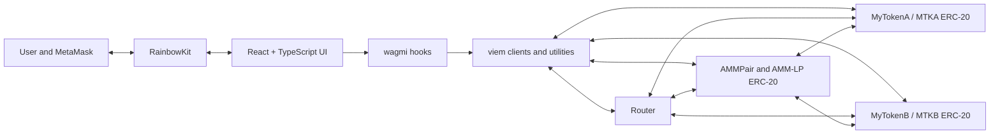

# AMM Pool

An educational constant-product automated market maker (AMM) for swapping
`MTKA` and `MTKB` on Ethereum Sepolia.

The project contains:

- Solidity smart contracts built and tested with Foundry.
- OpenZeppelin ERC-20 token and security primitives.
- A router for swaps and liquidity operations.
- A React, TypeScript, and Vite frontend.
- viem, wagmi, and RainbowKit for blockchain and wallet integration.

> [!WARNING]
> This project is intended for learning and testnet use. The contracts have not
> been audited and should not be used to manage assets with real value.

## Table of contents

- [Features](#features)
- [Deployed Sepolia contracts](#deployed-sepolia-contracts)
- [Smart contracts](#smart-contracts)
- [How the AMM works](#how-the-amm-works)
- [Architecture](#architecture)
- [Requirements](#requirements)
- [Install the project](#install-the-project)
- [Build and test the contracts](#build-and-test-the-contracts)
- [Deploy the contracts](#deploy-the-contracts)
- [Synchronize the frontend after deployment](#synchronize-the-frontend-after-deployment)
- [Run the frontend](#run-the-frontend)
- [Add MTKA, MTKB, and AMM-LP to MetaMask](#add-mtka-mtkb-and-amm-lp-to-metamask)
- [Using the application](#using-the-application)
- [Project structure](#project-structure)
- [Security and implementation notes](#security-and-implementation-notes)

## Features

### Wallet and network

- Connect a browser wallet through RainbowKit.
- Read the connected account with wagmi.
- Restrict the application to Ethereum Sepolia.
- Submit transactions through the connected wallet and wait for receipts
  before refreshing the UI.

### Test token faucet

- Request `1 MTKA` or `1 MTKB` for any valid recipient address.
- Enforce a 24-hour cooldown per recipient and per token.
- Display transaction progress while the faucet transaction is pending.

The faucet tokens are transferred from the original deployer's token balance.
Each token initially mints `1,000,000` tokens to the deployment account.

### Token swaps

- Swap `MTKA` for `MTKB` or `MTKB` for `MTKA`.
- Fetch an on-chain quote from the pair contract.
- Display the current reserve ratio as an indicative exchange rate.
- Approve the input token and execute the swap through the router.
- Apply a 0.3% swap fee in the pair calculation.

### Liquidity management

- Add `MTKA` and `MTKB` liquidity through the router.
- Mint ERC-20 `AMM-LP` tokens representing a share of the pool.
- Select and remove 25%, 50%, 75%, or 100% of the connected wallet's LP
  position.
- Preview the approximate underlying tokens returned when liquidity is removed.

### Pool information

The frontend reads and displays:

- Current `MTKA` reserve.
- Current `MTKB` reserve.
- Total `AMM-LP` supply.
- Connected wallet's LP balance and percentage share.

## Deployed Sepolia contracts

The current deployment is recorded in
[`contracts/deployments/sepolia.json`](./contracts/deployments/sepolia.json)
and consumed by
[`frontend/src/contracts/addresses.tsx`](./frontend/src/contracts/addresses.tsx).

| Contract | Token name | Symbol | Decimals | Sepolia address |
| --- | --- | --- | ---: | --- |
| MyTokenA | MyTokenA | MTKA | 18 | `0x33881101F180B4d0EbBA82b1345a050540231336` |
| MyTokenB | MyTokenB | MTKB | 18 | `0xecd19E0658c8701FCbFaa71Ed5677F3341114024` |
| AMMPair / LP token | AMM LP Token | AMM-LP | 18 | `0x9BeF9E206323Da0b3709C9aEbC975Eb0109F992a` |
| Router | Not an ERC-20 token | N/A | N/A | `0x7EfED348D7eE8873A93670Cdc5d8CE1cc03963bB` |

The token referred to as the "AMML-pair" is the pair contract's LP token. Its
actual ERC-20 symbol is **`AMM-LP`**. The pair contract and LP token use the
same address because the `AMMPair` contract itself inherits OpenZeppelin's
`ERC20` contract.

## Smart contracts

The contracts use Solidity `0.8.27` and OpenZeppelin Contracts `v5.7.0`.

### `MyTokenA` and `MyTokenB`

[`MyTokenA.sol`](./contracts/src/MyTokenA.sol) and
[`MyTokenB.sol`](./contracts/src/MyTokenB.sol) are ERC-20 test tokens.

Both contracts:

- Inherit OpenZeppelin `ERC20`.
- Inherit OpenZeppelin `ERC20Permit`, adding EIP-2612 permit support.
- Use the standard OpenZeppelin default of 18 decimals.
- Mint an initial supply of `1,000,000` tokens to the constructor recipient.
- Expose a faucet that sends `1` token to a recipient once every 24 hours.
- Emit `FaucetClaimed` after a successful claim.

### `AMMPair`

[`AMMPair.sol`](./contracts/src/AMMPair.sol) is both the liquidity pool and the
ERC-20 LP token contract.

It uses:

- OpenZeppelin `ERC20` to mint and burn `AMM-LP` shares.
- OpenZeppelin `SafeERC20` for safe token transfers.
- OpenZeppelin `ReentrancyGuard` on state-changing pool operations.

The pair stores the two token addresses, tracks both reserves, quotes swaps,
adds and removes liquidity, and emits events for each pool operation.

### `Router`

[`Router.sol`](./contracts/src/Router.sol) is the frontend-facing entry point
for liquidity and swap transactions.

It:

- Is permanently connected to one `AMMPair` through an immutable reference.
- Validates token combinations, recipients, amounts, and deadlines.
- Pulls approved tokens from the user.
- Approves and calls the pair.
- Forwards swap output, LP tokens, or withdrawn assets to the recipient.
- Uses OpenZeppelin `SafeERC20` and `ReentrancyGuard`.

The router is not an ERC-20 token and should not be imported into MetaMask as
one.

## How the AMM works

The pool follows the constant-product model:

```text
x * y = k
```

`x` and `y` are the token reserves and `k` is their product.

For swaps, the input used by the pricing calculation is:

```text
amountInWithFee = amountIn * 997 / 1000
```

This keeps a 0.3% fee in the pool. For an `MTKA -> MTKB` swap, the simplified
output calculation is:

```text
k = reserveMTKA * reserveMTKB
newReserveMTKA = reserveMTKA + amountInWithFee
amountOut = reserveMTKB - (k / newReserveMTKA)
```

Initial LP shares are minted using:

```text
liquidity = sqrt(amountMTKA * amountMTKB)
```

Later deposits mint the smaller proportional amount implied by the two pool
reserves, preventing a depositor from receiving more LP shares than either
side of the deposit supports.

When liquidity is removed, the LP tokens are burned and the provider receives
the same proportion of both reserves as the burned share represented.

## Architecture

### High-level schema

```text
                  USER
                    |
                    v
           React / TypeScript
                    |
          wagmi + viem + Wallet
                    |
                    v
               AMM Router
              /          \
             v            v
       MTKA / MTKB      AMMPair
       ERC-20 tokens    Liquidity Pool + LP
                            |
                            v
                      Token Reserves
```

The user interacts with the React frontend through a connected wallet. wagmi
provides the React hooks and wallet state, while viem handles typed Ethereum
data, contract calls, transaction receipts, addresses, and token units. Write
operations go through the router, which coordinates the MTKA and MTKB ERC-20
contracts with the AMMPair. The pair holds the token reserves and is itself the
ERC-20 contract that mints and burns `AMM-LP` liquidity shares.

### Detailed component flow



### Frontend blockchain layer

The frontend uses viem directly for units, address validation, and a Sepolia
public client:

- `parseUnits` converts user-entered token amounts to 18-decimal integers.
- `formatUnits` converts on-chain integers back to display values.
- `isAddress` validates faucet recipient addresses.
- `createPublicClient` with `http()` creates a Sepolia read client in
  [`frontend/src/config.ts`](./frontend/src/config.ts).

wagmi is built on viem and supplies the React integration:

- `useAccount` reads the connected address.
- `useReadContract` reads reserves, quotes, token balances, and LP supply.
- `useWriteContract` sends approvals, faucet requests, swaps, and liquidity
  transactions.
- `usePublicClient` waits for transaction receipts.

[`frontend/src/wagmi.ts`](./frontend/src/wagmi.ts) configures RainbowKit and
wagmi for Sepolia. TanStack Query manages asynchronous query state underneath
the wagmi hooks.

### Transaction flow

#### Swap

1. The user approves the router to spend the input ERC-20.
2. The router pulls the input from the user.
3. The router approves and calls the pair.
4. The pair performs the constant-product swap and sends output to the router.
5. The router forwards the output token to the selected recipient.

#### Add liquidity

1. The user approves the router for both tokens.
2. The router pulls `MTKA` and `MTKB`.
3. The router approves and deposits both tokens into the pair.
4. The pair mints `AMM-LP` to the router.
5. The router transfers the LP tokens to the recipient.

#### Remove liquidity

1. The user approves the router to spend `AMM-LP`.
2. The router pulls the selected LP amount.
3. The pair burns those LP tokens and returns both underlying tokens.
4. The router transfers `MTKA` and `MTKB` to the recipient.

## Requirements

Install the following tools:

- [Git](https://git-scm.com/)
- [Foundry](https://book.getfoundry.sh/getting-started/installation)
- [Node.js](https://nodejs.org/) with npm
- [MetaMask](https://metamask.io/) or another RainbowKit-compatible wallet

For Sepolia deployment, you also need:

- A Sepolia RPC URL from a provider such as Alchemy, Infura, or QuickNode.
- A dedicated testnet deployment account.
- Sepolia ETH in that account to pay gas.

> [!IMPORTANT]
> Never commit a private key or place a wallet containing real assets into a
> development environment. Use a dedicated testnet wallet.

## Install the project

Clone the repository:

```powershell
git clone https://github.com/wildcat010/amm.git
Set-Location .\amm
```

Install the pinned Foundry libraries. The libraries are ignored by Git and
must be restored in a fresh clone:

```powershell
Set-Location .\contracts
forge install foundry-rs/forge-std@v1.16.2 --no-git
forge install OpenZeppelin/openzeppelin-contracts@v5.7.0 --no-git
Set-Location ..
```

Install the frontend packages from the lockfile:

```powershell
Set-Location .\frontend
npm ci
Set-Location ..
```

## Build and test the contracts

From the repository root:

```powershell
Set-Location .\contracts
forge build
forge test -vv
Set-Location ..
```

Other useful Foundry commands:

```powershell
# Check Solidity formatting without changing files
forge fmt --check

# Run one test contract with detailed traces
forge test --match-contract AMMPairTest -vvvv

# Display a gas report
forge test --gas-report
```

## Deploy the contracts

Deployment is intentionally split into two scripts:

1. `Deploy.s.sol` deploys `MyTokenA`, `MyTokenB`, and `AMMPair`, then writes
   their addresses to `contracts/deployments/sepolia.json`.
2. After `Deploy.s.sol` succeeds, `DeployRouter.s.sol` reads the pair address
   from that file, deploys the router, and adds its address to the same file.

Run the scripts in exactly this order: **Deploy first, then DeployRouter**.
Both broadcast commands below use `--gas-estimate-multiplier 1000`. Foundry
interprets this value as a relative percentage, so `1000` gives transactions a
gas limit equal to 1000% (10 times) the estimated gas. It does not multiply the
network gas price by 1000.

### 1. Configure deployment secrets

Open PowerShell in the repository root and set temporary environment
variables for the current terminal session:

```powershell
$env:SEPOLIA_RPC_URL = "https://your-sepolia-rpc-url"
$env:PRIVATE_KEY = "0xYOUR_TESTNET_PRIVATE_KEY"
```

Do not put these values in source files. The repository ignores `.env` files,
but terminal-scoped environment variables reduce the chance of accidentally
committing a secret.

### 2. Build and test before deployment

```powershell
Set-Location .\contracts
forge build
forge test -vv
```

### 3. Deploy MTKA, MTKB, and the pair

```powershell
forge script .\script\Deploy.s.sol:Deploy `
  --rpc-url $env:SEPOLIA_RPC_URL `
  --private-key $env:PRIVATE_KEY `
  --gas-estimate-multiplier 1000 `
  --broadcast `
  -vvvv
```

This deploys:

- `MyTokenA` with symbol `MTKA`.
- `MyTokenB` with symbol `MTKB`.
- `AMMPair`, which also creates the `AMM-LP` ERC-20.

The script prints all three addresses and writes them to:

```text
contracts\deployments\sepolia.json
```

### 4. Deploy the router

Run this only after the first script has successfully created the deployment
file:

```powershell
forge script .\script\DeployRouter.s.sol:DeployRouter `
  --rpc-url $env:SEPOLIA_RPC_URL `
  --private-key $env:PRIVATE_KEY `
  --gas-estimate-multiplier 1000 `
  --broadcast `
  -vvvv
```

`DeployRouter` reads the previously deployed pair address from
`deployments\sepolia.json`, passes that address to the `Router` constructor,
deploys the router, and writes the new router address back to the same JSON
file. You do not need to pass the pair address manually, but both deployment
commands must be run from the `contracts` directory and in the documented
order.

Inspect the final deployment data:

```powershell
Get-Content .\deployments\sepolia.json
```

The current script stores the router under a nested `router.router` key:

```json
{
  "pair": "0x...",
  "tokenA": "0x...",
  "tokenB": "0x...",
  "router": {
    "router": "0x..."
  }
}
```

### Optional: deploy from Bash

```bash
export SEPOLIA_RPC_URL="https://your-sepolia-rpc-url"
export PRIVATE_KEY="0xYOUR_TESTNET_PRIVATE_KEY"

cd contracts
forge build
forge test -vv
forge script script/Deploy.s.sol:Deploy \
  --rpc-url "$SEPOLIA_RPC_URL" \
  --private-key "$PRIVATE_KEY" \
  --gas-estimate-multiplier 1000 \
  --broadcast \
  -vvvv
forge script script/DeployRouter.s.sol:DeployRouter \
  --rpc-url "$SEPOLIA_RPC_URL" \
  --private-key "$PRIVATE_KEY" \
  --gas-estimate-multiplier 1000 \
  --broadcast \
  -vvvv
```

## Synchronize the frontend after deployment

Every deployment produces new contract addresses. Copy the new values from
[`contracts/deployments/sepolia.json`](./contracts/deployments/sepolia.json)
into [`frontend/src/contracts/addresses.tsx`](./frontend/src/contracts/addresses.tsx):

```ts
export const CONTRACTS = {
  sepolia: {
    pair: "0xYOUR_NEW_PAIR_ADDRESS",
    tokenA: "0xYOUR_NEW_MTKA_ADDRESS",
    tokenB: "0xYOUR_NEW_MTKB_ADDRESS",
    router: {
      router: "0xYOUR_NEW_ROUTER_ADDRESS",
    },
  },
} as const;
```

If contract interfaces changed, rebuild and copy the updated Foundry artifacts
to the frontend. From the repository root:

```powershell
Set-Location .\contracts
forge build
Set-Location ..

Copy-Item .\contracts\out\MyTokenA.sol\MyTokenA.json .\frontend\src\contracts\MyTokenA.json -Force
Copy-Item .\contracts\out\MyTokenB.sol\MyTokenB.json .\frontend\src\contracts\MyTokenB.json -Force
Copy-Item .\contracts\out\AMMPair.sol\AMMPair.json .\frontend\src\contracts\AMMPair.json -Force
Copy-Item .\contracts\out\Router.sol\Router.json .\frontend\src\contracts\Router.json -Force
```

Restart the Vite development server after changing addresses or artifacts.

## Run the frontend

```powershell
Set-Location .\frontend
npm ci
npm run dev
```

Open the local URL printed by Vite, normally `http://localhost:5173`.

The wallet must be connected to Sepolia. RainbowKit will show **Wrong network**
when the connected chain is unsupported.

Available frontend commands:

```powershell
npm run dev      # Start the Vite development server
npm run build    # Type-check and create a production build
npm run lint     # Run ESLint
npm run preview  # Preview the production build locally
```

## Add MTKA, MTKB, and AMM-LP to MetaMask

### 1. Enable and select Sepolia

1. Open MetaMask.
2. Open **Settings** and enable **Show test networks** if Sepolia is hidden.
3. Select **Sepolia** from the network selector.
4. Confirm that MetaMask shows **Sepolia**, not Ethereum Mainnet.

Tokens imported on the wrong network will not show the balances from this
deployment.

### 2. Import MTKA

1. On the MetaMask Tokens screen, select **Import tokens**.
2. Select **Custom token** if MetaMask presents multiple import methods.
3. Enter the following values:

| Field | Value |
| --- | --- |
| Token contract address | `0x33881101F180B4d0EbBA82b1345a050540231336` |
| Token symbol | `MTKA` |
| Token decimals | `18` |

4. Select **Next** or **Import** and confirm the token.

### 3. Import MTKB

Repeat the process with:

| Field | Value |
| --- | --- |
| Token contract address | `0xecd19E0658c8701FCbFaa71Ed5677F3341114024` |
| Token symbol | `MTKB` |
| Token decimals | `18` |

### 4. Import the AMM-LP pair token

The pair contract is also the LP ERC-20 token contract. Import it with:

| Field | Value |
| --- | --- |
| Token contract address | `0x9BeF9E206323Da0b3709C9aEbC975Eb0109F992a` |
| Token symbol | `AMM-LP` |
| Token decimals | `18` |

An `AMM-LP` balance appears only after that wallet adds liquidity and receives
LP shares. Do not import the router address as a token.

If you redeploy the contracts, use the new addresses in
`contracts\deployments\sepolia.json` instead of the addresses above.

## Using the application

1. Connect MetaMask and switch to Sepolia.
2. Obtain Sepolia ETH from a testnet faucet to pay transaction fees.
3. Open **Get MTKA & MTKB**, enter your wallet address, and request both
   tokens.
4. Open **Add liquidity** and deposit both tokens. Each token requires a
   separate approval, followed by the add-liquidity transaction.
5. Import `AMM-LP` into MetaMask to see the received LP balance.
6. Use **Swap** to approve and exchange one test token for the other.
7. Use **Remove liquidity** to approve LP tokens and withdraw a selected
   percentage of the underlying pool assets.

Each approval and contract call is a separate Sepolia transaction and requires
testnet ETH.

## Project structure

```text
amm\
|-- contracts\
|   |-- deployments\
|   |   `-- sepolia.json
|   |-- script\
|   |   |-- Deploy.s.sol
|   |   `-- DeployRouter.s.sol
|   |-- src\
|   |   |-- AMMPair.sol
|   |   |-- MyTokenA.sol
|   |   |-- MyTokenB.sol
|   |   `-- Router.sol
|   |-- test\
|   |-- foundry.lock
|   `-- foundry.toml
|-- frontend\
|   |-- src\
|   |   |-- components\
|   |   |-- contracts\
|   |   |-- App.tsx
|   |   |-- config.ts
|   |   `-- wagmi.ts
|   |-- package-lock.json
|   `-- package.json
`-- README.md
```

## Security and implementation notes

- OpenZeppelin `SafeERC20` is used instead of assuming all ERC-20 contracts
  return transfer booleans consistently.
- `AMMPair` and `Router` use `ReentrancyGuard` on state-changing entry points.
- Router methods validate deadlines to reject expired transactions.
- The pair supports minimum-output checks for swap slippage protection.
- The current frontend passes `0` as the minimum output and minimum withdrawal
  amounts. That means the contracts support slippage limits, but the current UI
  does not enforce user-configurable protection.
- The frontend is configured only for Sepolia and uses contract addresses
  committed in the source tree.
- This AMM is a compact educational implementation. It does not include all
  production DEX protections, optimizations, governance, oracle safeguards, or
  protocol controls.
